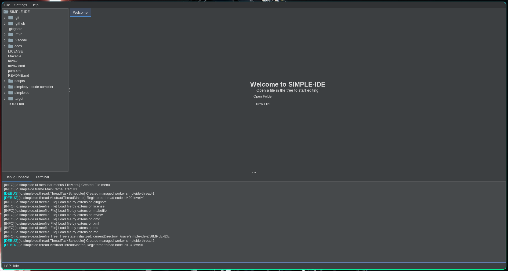
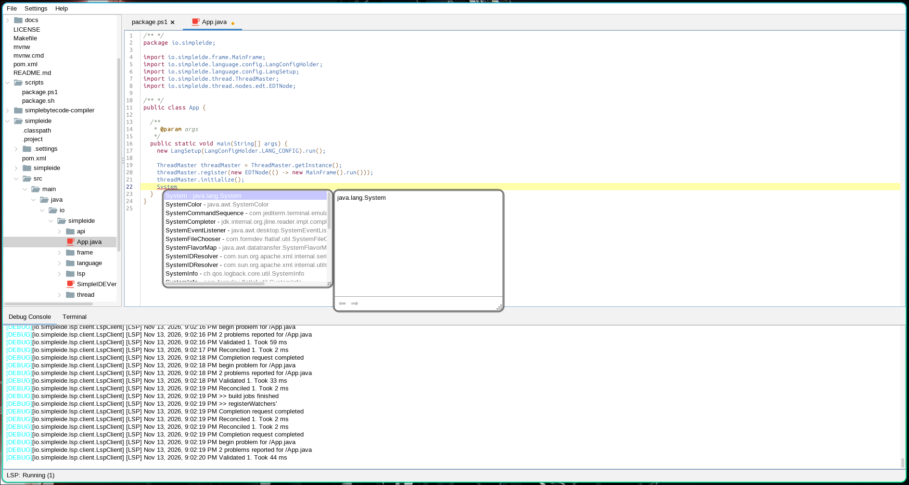
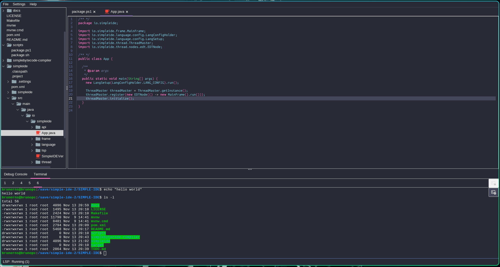
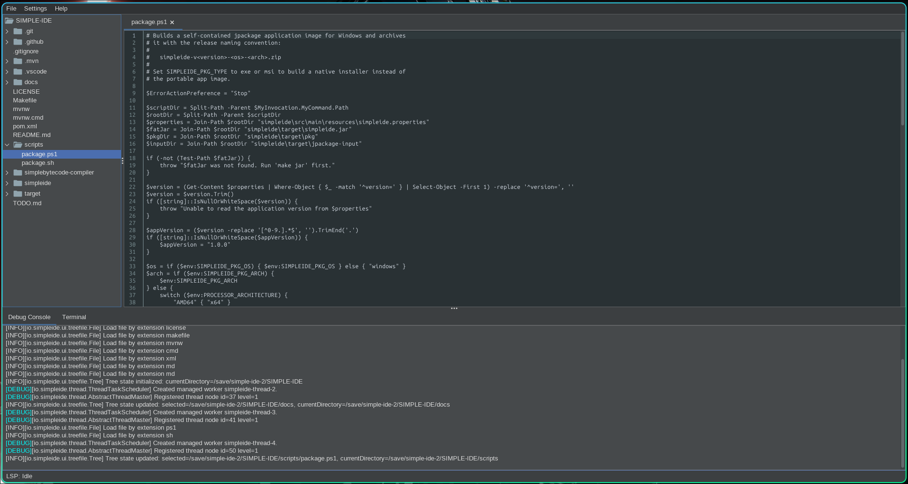

# SIMPLE-IDE

A simple, lightweight, extensible IDE written in Java Swing — usable as a
standalone editor or as a component toolkit for building bigger, more specific
IDEs.

[](LICENSE)
[](https://adoptium.net/)
[](https://maven.apache.org/)

[](https://github.com/BrunoRNS/SIMPLE-IDE/releases)
[](https://github.com/BrunoRNS/SIMPLE-IDE/actions/workflows/linux64.yml)
[](https://github.com/BrunoRNS/SIMPLE-IDE/actions/workflows/windows64.yml)
[](https://github.com/BrunoRNS/SIMPLE-IDE/actions/workflows/macos-arm.yml)

## Screenshots

| | |
| --- | --- |
|  |  |
|  |  |

More pictures and what each one shows: [Screenshots showcase](docs/screenshots/README.md).

## Where it fits

Simple IDE is part of a planned architecture meant to be **integrated into
larger, more specific IDEs**: every subsystem (editor, terminal, threading,
language runner, LSP client) can be embedded independently through the public
API in [`io.simpleide.api`](docs/api/README.md). It also works perfectly well
**on its own** as a complete desktop editor.

- Standalone: a fast, small editor with run support for 10 languages and a
  terminal that needs no BusyBox installation.
- Embedded: grab `Editors`, `SimpleEditor`, `Threads`, `Languages`, `Terminals`
  or `SimpleIDE` and drop them into your own Swing application.

## Choosing how to use it

| You are | Path | Jump to |
| --- | --- | --- |
| Most users — add it as a library | Maven or Gradle dependency | [Maven / Gradle](#maven--gradle-recommended) |
| Advanced user — run the packaged app | Release JAR or package | [Fat JAR / package](#fat-jar--package-advanced-users) |
| Super advanced user / developer | Build from source | [From source](#from-source-super-advanced-users--developers) |

### Maven / Gradle (recommended)

Add the JitPack repository and depend on the module you need:

```xml
<repositories>
  <repository>
    <id>jitpack.io</id>
    <url>https://jitpack.io</url>
  </repository>
</repositories>

<dependency>
  <groupId>com.github.BrunoRNS.SIMPLE-IDE</groupId>
  <artifactId>simpleide</artifactId>
  <version>v1.0.0beta</version>
</dependency>
```

```groovy
repositories { maven { url 'https://jitpack.io' } }
dependencies {
    implementation 'com.github.BrunoRNS.SIMPLE-IDE:simpleide:v1.0.0beta'
}
```

Then embed any component:

```java
// A full editor tab with search, line numbers and lazy LSP:
SimpleEditor editor = SimpleEditor.open(Path.of("Main.java"));
frame.add(editor.component());

// Or the whole IDE:
SimpleIDE.launch();
```

Prefer no repository setup? Download the release JAR and install it locally —
see [Artifacts and imports](docs/api/artifacts.md). To consume only the
compiler module use the `simplebytecode-compiler` artifact.

### Fat JAR / package (advanced users)

Download from [Releases](https://github.com/BrunoRNS/SIMPLE-IDE/releases):

- `simpleide-v<version>-any-with-deps.jar` — platform-independent, run with
  `java -jar`.
- `simpleide-v<version>-<os>-<arch>.zip` — self-contained static package for
  Linux and Windows, no installation step.
- `simpleide-v<version>-linux-<arch>.deb` / `.rpm`,
  `simpleide-v<version>-macos-<arch>.dmg` and
  `simpleide-v<version>-windows-<arch>.msi` — native installers per platform.

Beta versions (e.g. `1.0.0beta`) are published as pre-releases.

### From source (super advanced users / developers)

Requirements: JDK 17+, GNU Make (optional). Build, test and run:

```sh
make jar          # executable fat JAR -> simpleide/target/simpleide.jar
make run          # launch it
make pkg          # jpackage app image for this OS/arch
```

Without Make, use the wrapper (`mvnw.cmd` on Windows): `./mvnw -DskipTests
package`. Development workflow, branch model and tests:
[Contributing](docs/development/CONTRIBUTING.md).

## Features

- RSyntaxTextArea editor: highlighting, folding, auto-indent, search/replace,
  local completion.
- Optional LSP: diagnostics, completion, go-to-definition, formatting —
  servers are downloaded on demand, editors degrade gracefully without them.
- Run Java, Kotlin, Groovy, JavaScript, Python, C, C++, C#, Go and Rust;
  input/output routed through managed processes.
- Embedded BusyBox terminal per platform, no runtime download.
- FlatLaf themes, project tree with file watching, `ThreadMaster` task
  management.

## Team

Maintainers:

| Maintainer | GitHub | Contact |
| --- | --- | --- |
| Bruno R. N. S. | [@BrunoRNS](https://github.com/BrunoRNS) | <brunorns05@outlook.com> |
| Luis Otávio | [@LuisOtavio13](https://github.com/LuisOtavio13) | <roberdoogarcia@gmail.com> |
| Luis Batistel | [@luisotavio15](https://github.com/luisotavio15) | <luis.batistel.leite@escola.pr.gov.br> |

Everyone else is welcome as a **collaborator**: open an issue or a pull
request and you are in. See [Contributing](docs/development/CONTRIBUTING.md)
for the process.

## Documentation

- [Documentation index](docs/README.md)
- [API reference and integration guide](docs/api/README.md)
- [Languages](docs/reference/LANGUAGES.md) ·
  [LSP](docs/reference/LSP.md) ·
  [Threading](docs/reference/THREADMASTER.md)
- [Build, test and packaging](docs/build/MAKEFILE.md) ·
  [Releases](docs/build/RELEASES.md)
- [Third-party dependencies and licenses](docs/third-party/README.md)

## License

Simple IDE is licensed under the [BSD 3-Clause License](LICENSE). Bundled
components keep their own licenses — notably BusyBox (GPLv2, with source
archives bundled) and the Maven libraries listed in the
[license inventory](docs/third-party/LICENSES.md).
