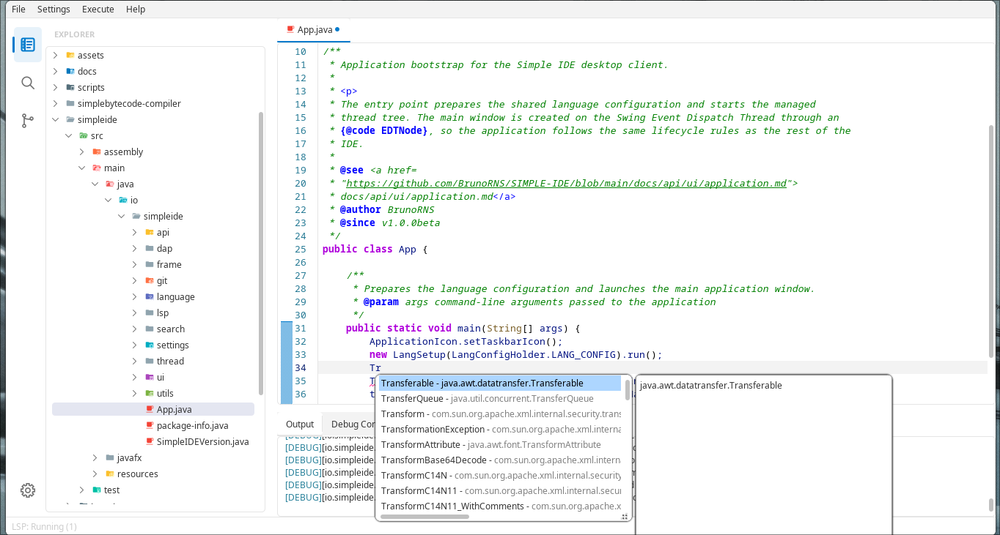
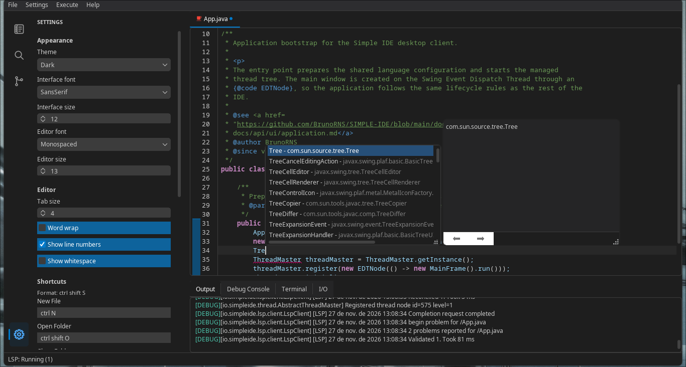
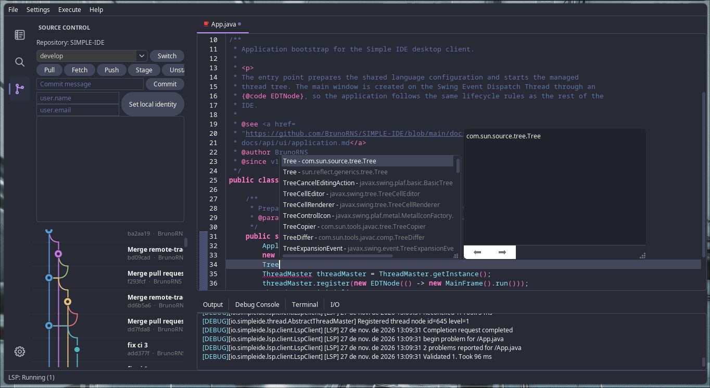
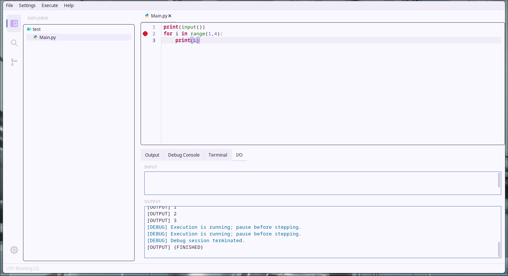
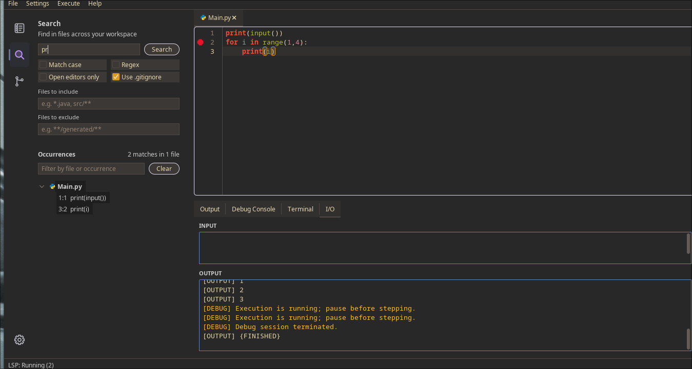
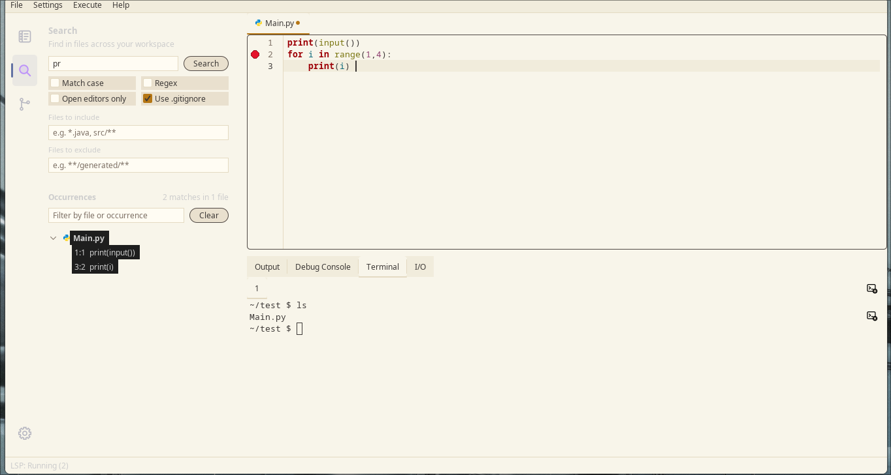

# Simple IDE screenshots

Screenshots are grouped in one directory per release (`<version>/`) so each
release keeps its own visual record. File names follow
`simpleide-<panel>-theme<theme>[-<detail>]-v<version>.png`: the panel, the theme
and the version are enough to identify the image without opening it.

## Current version — 1.1.0

Captured at approximately Full HD resolution (1920 × 1080 class) on the 1.1.0
build.

### Editor, dark theme, Java completion

What it shows: a Java file open in the editor with the dark theme, the language
server running (status bar) and the member completion popup above the caret.

### Settings, dark theme

What it shows: the Settings page with appearance (theme, interface and editor
fonts, sizes), editor options (tab size, word wrap, line numbers, whitespace)
and the keyboard shortcut list.

### Source Control, Dracula theme

What it shows: the Git panel with branch switching, pull/fetch/push/stage
actions, commit message box and the commit graph with merge entries.

### Debug console, light theme, Python

What it shows: a Python file paused in a debug session, with the Output, Debug
Console, Terminal and I/O tabs and the input/output panes below them.

### Search, Brown theme

What it shows: the workspace search panel with match case / regex / open
editors only / use .gitignore options, include and exclude filters, and the
match list grouped by file.

### Terminal, Brown light theme

What it shows: the embedded terminal with an active shell session over the
light Brown theme, together with the search results panel.

## Previous version — 1.0.0beta

The 1.0.0beta screenshots are kept in [`1.0.0/`](1.0.0/), and the documented
tour of that release — startup, open editor, autocomplete, theme selector,
Brown and Dracula themes, terminal and Help → About — is on its own page:

- [1.0.0beta screenshots](https://github.com/BrunoRNS/SIMPLE-IDE/wiki/Screenshots-1.0.0)

## Adding new screenshots

- Capture the image at approximately Full HD (1920 × 1080 class) so it stays
  readable in the repository and in the README.
- Put it in the directory of the release it documents and name it
  `simpleide-<panel>-theme<theme>[-<detail>]-v<version>.png`.
- Add a short section here describing which panel and theme it shows, with a
  relative image link.
- When the release changes, keep the old directory untouched and create a new
  one; the README section of the previous version should point to its own page
  or directory instead of repeating every image.
