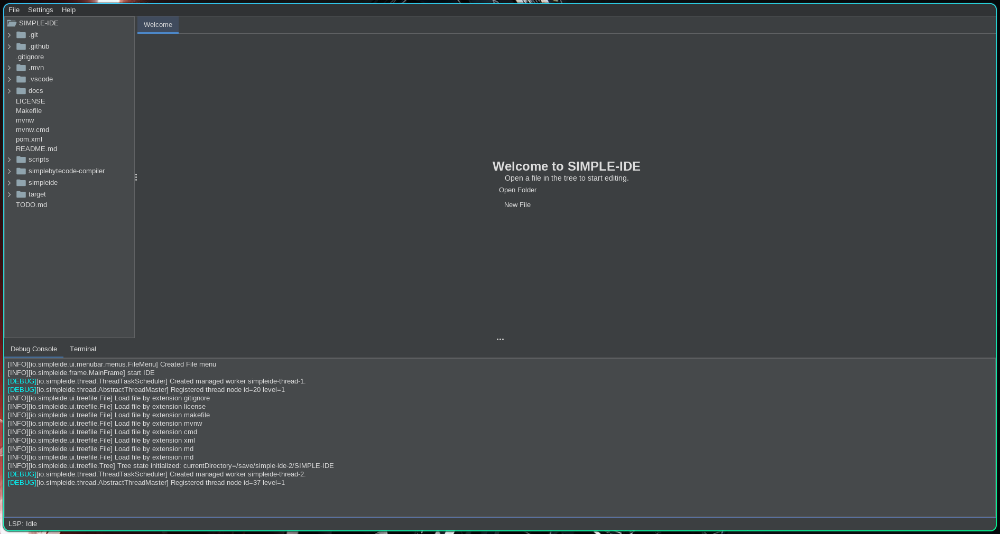
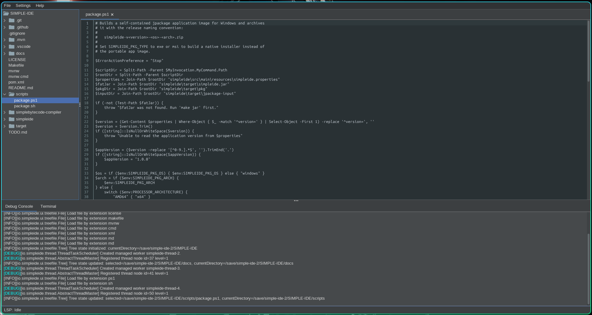
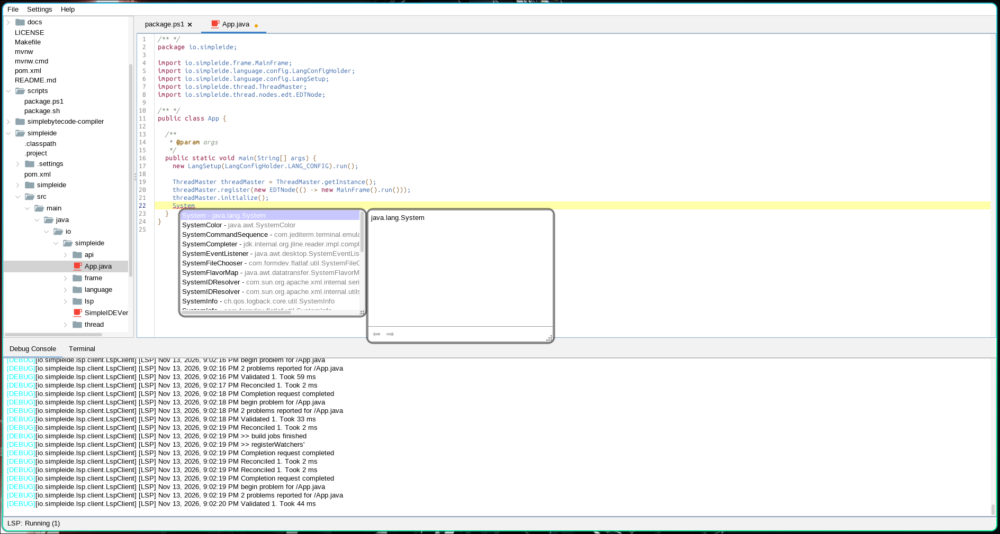
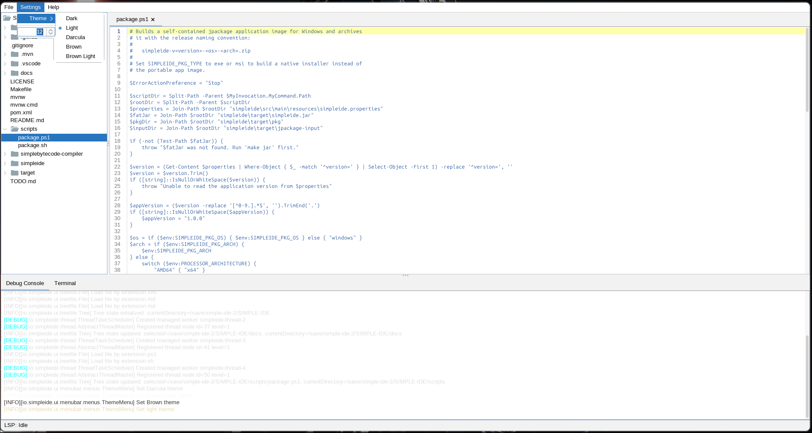
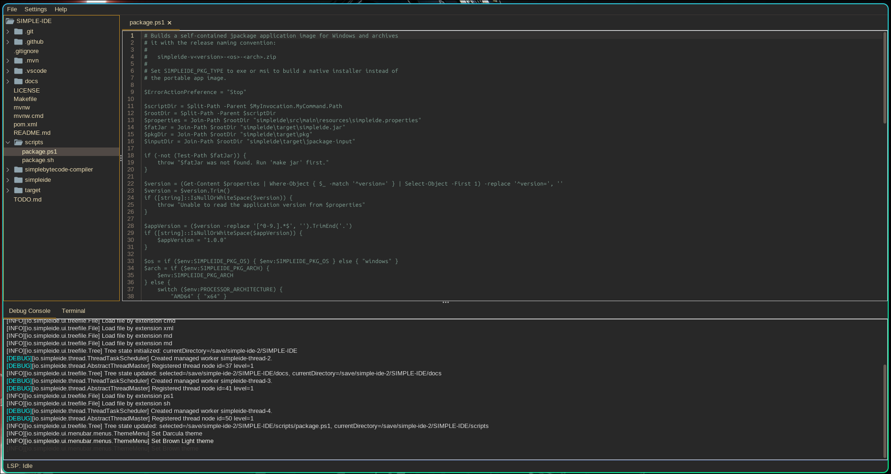
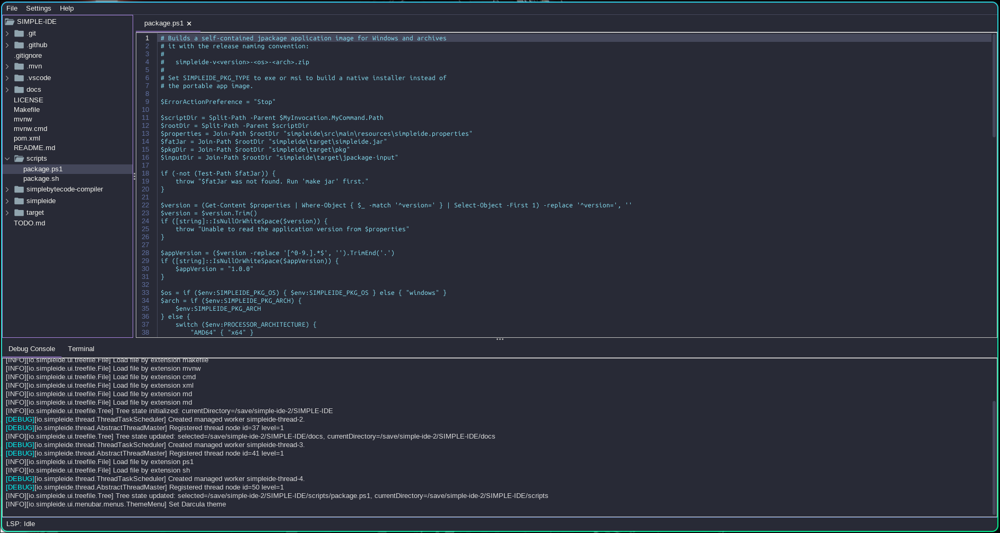
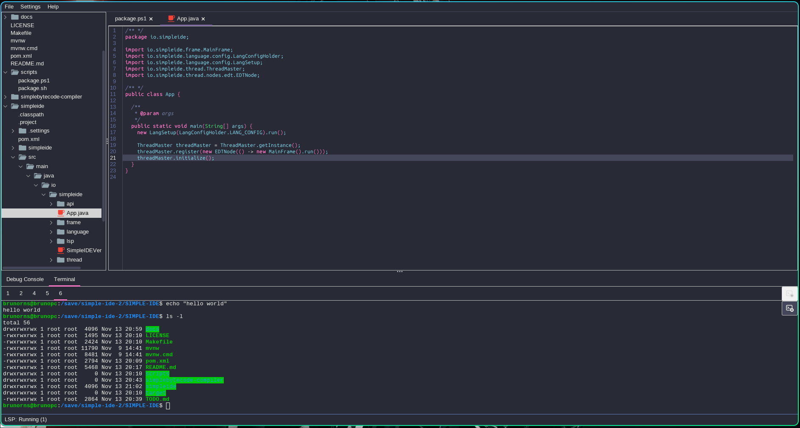
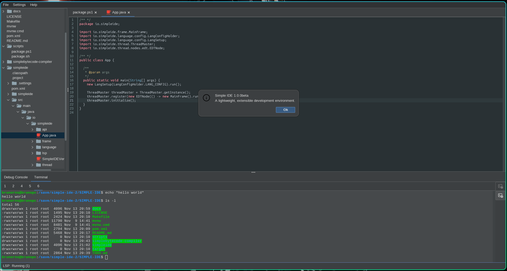

# Simple IDE screenshots — version 1.0.0beta

All screenshots below were captured at approximately Full HD resolution
(1920 × 1080 class) on the 1.0.0beta build. File names describe the theme,
state and panel shown. Use them when writing articles, reviews or issues.

## Startup — home page, default dark theme

What it shows: the first screen after launching the IDE with no file open —
project tree, editor area, status bar and the embedded terminal ready.

## Editor with an open file, dark theme

What it shows: a source file opened in the RSyntaxTextArea editor with
line numbers, syntax highlighting and the search panel, without any language
server connected (local highlighting only).

## Autocomplete, light theme, Java

What it shows: local Java completion in action while typing in the light
theme.

## Theme selector, light theme

What it shows: the theme menu open with a file loaded, before switching
themes.

## Brown theme

What it shows: one of the FlatLaf-based themes with a file open and no
language server.

## Dracula theme, debug console

What it shows: the Dracula theme with the debug/log console visible while a
file is open.

## Dracula theme, terminal

What it shows: the embedded BusyBox terminal with an active session under the
Dracula theme.

## Help → About, dark theme, Java language

What it shows: the About dialog over a Java file and a running terminal, with
the dark theme applied.

## Notes

- These images are the visual record of the 1.0.0beta interface. When the UI
  changes significantly, capture new screenshots and add them next to these
  files, keeping the naming convention
  `simpleide-<theme>-<state>-v<version>.png`.
- Keep the resolution near Full HD so the images are readable both in the
  repository and in the README.
